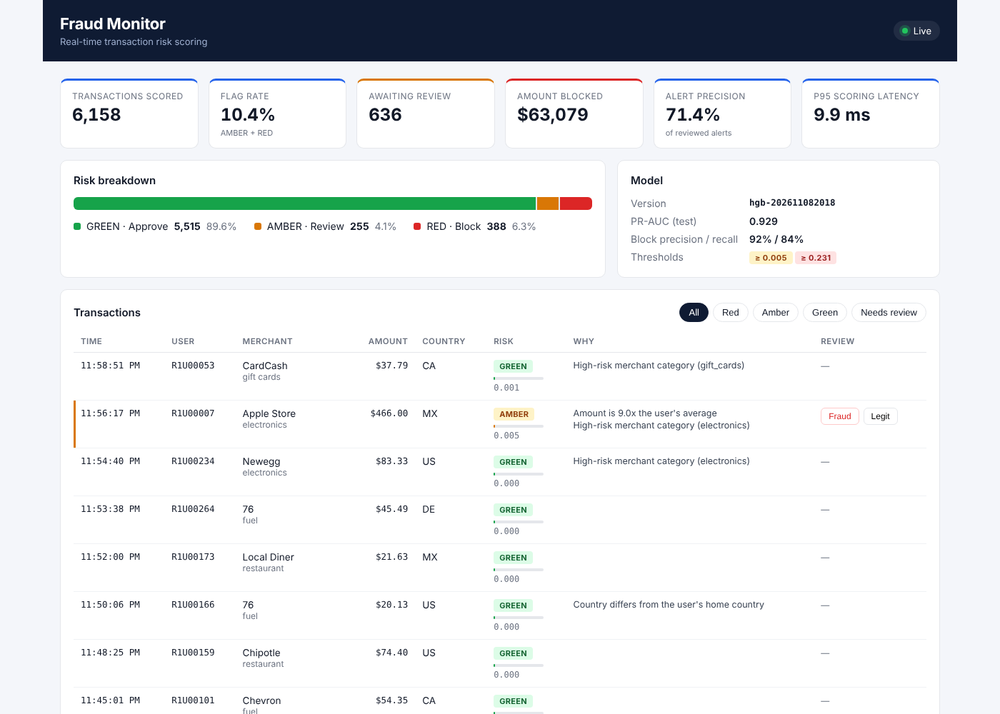
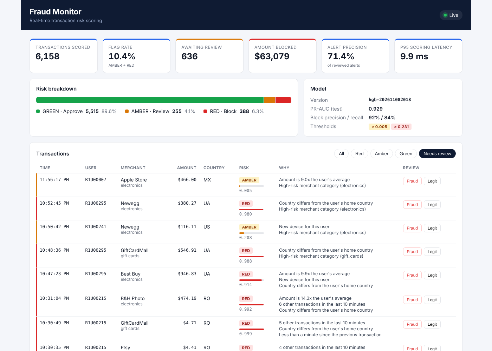
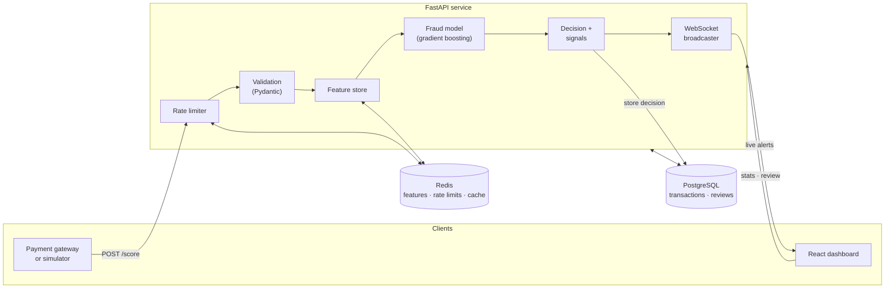
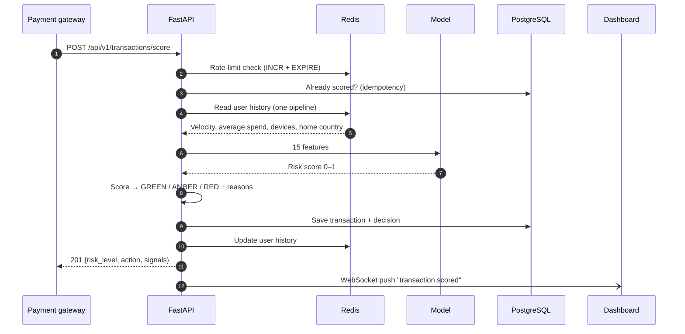
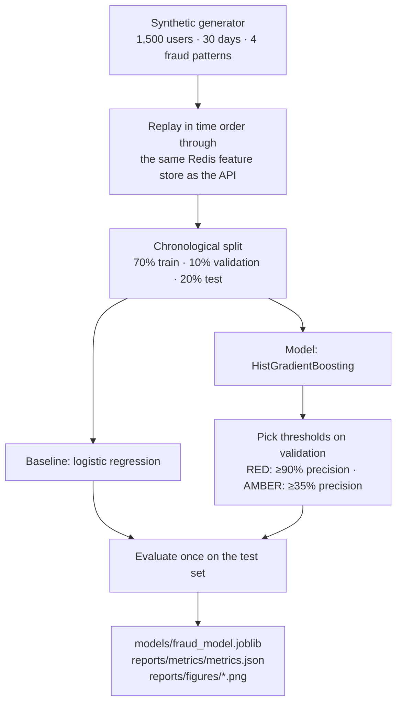
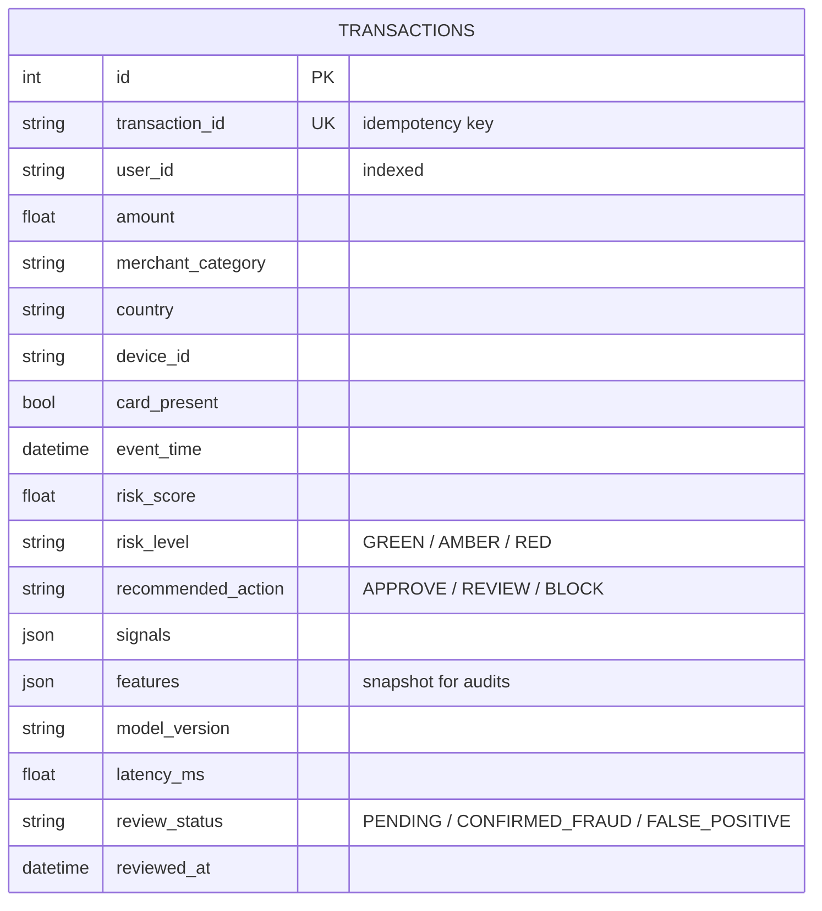
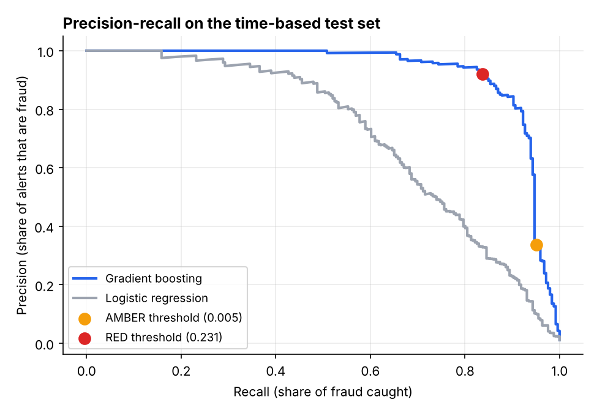
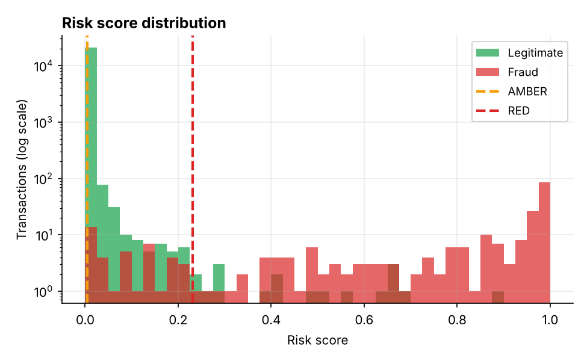
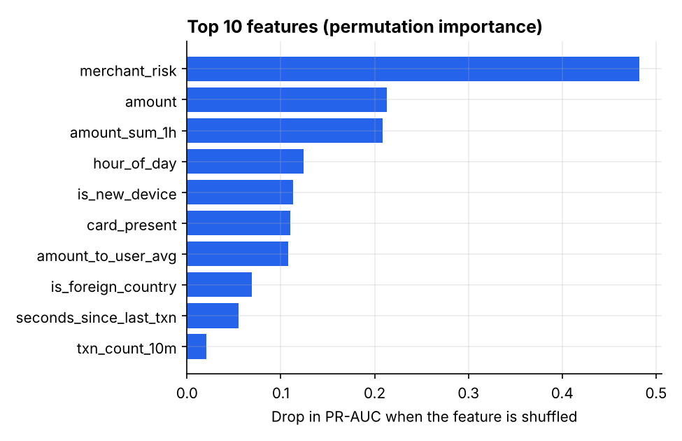
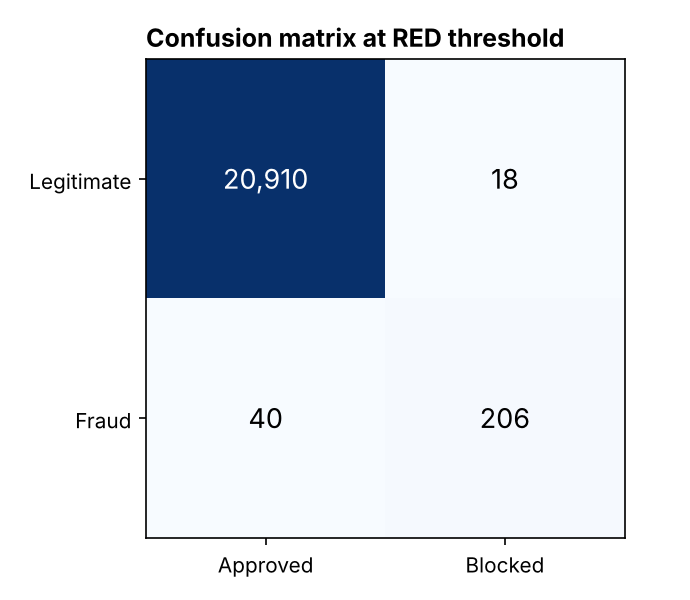

# 💳 Real-Time Transaction Fraud Scoring Service

A full-stack fraud detection system that scores every card transaction in about **10 milliseconds**, decides whether to **approve, review or block** it, explains *why*, and streams alerts live to an analyst dashboard. Built with **FastAPI, PostgreSQL, Redis, scikit-learn, React and Docker**.


[](https://github.com/aish-19shanbhag/fraud-scoring-service/actions/workflows/ci.yml)


| | |
|---|---|
| **Problem** | Stop fraudulent card payments *before* they are approved, without blocking good customers or flooding analysts with false alarms |
| **Data** | 105,868 synthetic transactions from 1,500 customers over 30 days, with 4 realistic fraud patterns (1.14% fraud rate) |
| **Approach** | Real-time behavioural features in Redis → gradient-boosted model → risk thresholds tuned for precision → REST API + live WebSocket dashboard |
| **Result** | PR-AUC **0.929** (vs 0.715 for logistic regression); auto-blocks fraud at **92% precision** and **84% recall** with a **0.09% false positive rate**; p95 scoring latency **~11 ms** |
| **Stack** | Python · FastAPI · SQLAlchemy · PostgreSQL · Redis · scikit-learn · React · Docker · GitHub Actions |

## Highlights

- **Real-time scoring:** one API call computes 15 behavioural features from Redis, runs the model and stores the decision. In-service scoring p95 is **~11 ms**; full round trip including the database write is **p50 16 ms / p95 20 ms**.
- **Precision-first decisions:** thresholds are tuned on validation data so **92% of auto-blocks are real fraud**, while the review band catches **95% of all fraud** on the time-based test set.
- **Explainable alerts:** every flagged transaction lists plain-English reasons, such as *"Amount is 21.2x the user's average"* or *"New device for this user"*.
- **Live analyst dashboard:** a React app shows alerts the moment they are scored (WebSockets), with one-click *Fraud / Legit* review that feeds alert-precision metrics.
- **Production patterns:** idempotent API, Redis rate limiting and caching, health checks, input validation, Dockerized services, and CI on every push (lint, 19 automated tests, ~94% coverage, image builds).
- **Honest evaluation:** a chronological train/validation/test split (no peeking at the future), a baseline comparison, and per-pattern recall that openly shows the hardest fraud type.

## ✨ Key features

| | Feature | What it does |
|---|---|---|
| ⚡ | Real-time scoring API | `POST /api/v1/transactions/score` returns a risk score, risk level and action in milliseconds |
| 🧠 | Behavioural features in Redis | Spending velocity, amount vs. the user's average, new device, foreign country and time since last purchase, all from Redis sorted sets and hashes |
| 🚦 | Three-level decisions | GREEN → approve · AMBER → send to analyst review · RED → block |
| 🔍 | Explainable signals | Human-readable reasons attached to every decision |
| 📡 | Live dashboard | React + WebSockets: new alerts appear instantly, with no page refresh |
| ✅ | Analyst review workflow | Confirm fraud or mark a false positive; review outcomes drive the alert-precision metric |
| 🔁 | Idempotency | Re-sending the same `transaction_id` returns the original decision, so retries never double-charge the feature store |
| 🛡️ | Rate limiting | Per-client fixed-window limiter in Redis (HTTP 429 + `Retry-After`) |
| 🗄️ | Caching | Dashboard stats cached in Redis for 2 s, so polling dashboards don't hammer PostgreSQL |
| 🎲 | Traffic simulator | Streams realistic customers and fraud attacks to the API for demos |
| 📈 | Load testing | Locust scenario plus a latency benchmark script |
| 🐳 | One-command setup | `docker compose up --build` starts PostgreSQL, Redis, the API, the simulator and the dashboard |
| 🔄 | CI/CD | GitHub Actions: Ruff lint, pytest with an 85% coverage gate, frontend build, Docker builds |

## Why it matters

Card fraud is a **rare-event** problem with **uneven costs**. A missed fraud means a chargeback and a customer who loses trust. A false alarm blocks a real customer at checkout, and too many alerts bury the analysts who have to review them. That's why this project:

- reports **precision, recall and false positive rate**, not accuracy (a model that approves everything would be about 99% "accurate" here and catch nothing)
- uses **two thresholds**: block only when the model is very sure, and send the grey zone to humans
- scores **before** approval, so speed is a hard requirement, not a nice-to-have

## Dashboard



*Review queue: each alert shows the reasons it was flagged, with one-click analyst decisions.*



## Architecture



### How one transaction is scored



### Training and evaluation workflow



### Data model



## Methodology

### 1. Data (`backend/ml/synthetic.py`)

Real card data is private, so the project generates realistic behaviour. Each customer has a home country, 1–2 devices, a typical spend level and active hours. To keep the problem honest, **legitimate behaviour includes the same "suspicious" signals fraud uses**: trips abroad, new phones, occasional big purchases, night owls and bursts of small app purchases.

| Fraud pattern | What happens | Share |
|---|---|---|
| Account takeover | New device, often a foreign country (or a VPN to the home country), high-value electronics or gift cards | 35% |
| Card testing | Burst of tiny online charges in minutes, then one large purchase | 25% |
| Stolen card details | A single ordinary-looking online purchase (deliberately hard) | 25% |
| Night spree | Several high-value card-not-present purchases between 1 and 5 am | 15% |

### 2. Features (`backend/app/feature_store.py`)

Computed from Redis in **one round trip**, using only the customer's *past* activity:

| Group | Features |
|---|---|
| Amount | `amount`, `log_amount`, `amount_to_user_avg` |
| Velocity | `txn_count_10m`, `txn_count_1h`, `amount_sum_1h`, `seconds_since_last_txn` |
| Identity | `is_new_device`, `is_foreign_country`, `is_new_user`, `user_history_count` |
| Context | `hour_of_day`, `is_night`, `merchant_risk`, `card_present` |

Training replays the history through the **same feature-store code** the API uses, so there is no train/serve skew.

### 3. Model and thresholds (`backend/ml/train.py`)

- **Model:** scikit-learn `HistGradientBoostingClassifier` (300 trees max, early stopping), compared against a scaled logistic regression baseline.
- **Split:** chronological 70/10/20. A random split would let the model learn from the future.
- **Thresholds:** chosen on validation data, never on test:
  - **RED (block):** lowest score where at least 90% of blocked transactions are fraud
  - **AMBER (review):** lowest score where at least 1 in 3 alerts is fraud, a typical analyst-queue target

## Results

All numbers are from the **held-out last 20% of time** (21,174 transactions, 246 fraud). Full output is in [`reports/metrics/metrics.json`](reports/metrics/metrics.json).

| Model | ROC-AUC | PR-AUC |
|---|---|---|
| Logistic regression (baseline) | 0.980 | 0.715 |
| **Gradient boosting** | **0.996** | **0.929** |

PR-AUC is the headline metric because fraud is only ~1% of traffic. Gradient boosting lifts it by **30%** over the baseline.

| Decision band | Threshold | Precision | Recall | False positive rate | Share of traffic flagged |
|---|---|---|---|---|---|
| **RED** (auto-block) | ≥ 0.231 | **92.0%** | **83.7%** | **0.09%** | 1.1% |
| **AMBER or RED** (review or block) | ≥ 0.005 | 33.6% | **95.1%** | 2.2% | 3.3% |

**Recall by fraud pattern** (AMBER or RED):

| Card testing | Account takeover | Night spree | Stolen card details |
|---|---|---|---|
| 100% | 98.1% | 97.9% | 64.3% |

<p>
  
  
</p>
<p>
  
  
</p>

### Performance

| Measure | Result |
|---|---|
| In-service scoring time (features + model), p50 / p95 | 8.8 ms / 11.2 ms |
| End-to-end `POST /score` incl. PostgreSQL write, p50 / p95 / p99 | 16.0 / 20.1 / 23.1 ms |
| Sustained throughput, 20 concurrent clients (Locust), single worker | ~77 requests/s, 0 errors |

*Measured on a 2-vCPU Linux VM with PostgreSQL, Redis and the load generator on the same machine, so this is a conservative floor. Re-run `scripts/benchmark_latency.py` and `loadtest/` on your own hardware.*

### Key findings

1. **Behaviour beats amount.** Merchant risk, amount, one-hour spend and new-device signals carry the model; amount alone would miss card testing, where the charges are tiny.
2. **Non-linear patterns matter.** Logistic regression ranks well (ROC-AUC 0.98) but its PR-AUC is far lower, because fraud is a *combination* of signals (new device **and** foreign **and** high amount) that trees capture naturally.
3. **The hardest fraud looks normal.** Stolen-card-details fraud is a single ordinary purchase, so only 64% is caught. Real systems add signals this project doesn't have, like device fingerprinting, IP reputation and merchant-level chargeback history.
4. **Two thresholds beat one.** One cut-off forces a choice between missing fraud and blocking customers. The AMBER band sends ~2% of traffic to humans and lifts total fraud capture from 84% to 95%.

## API reference

Interactive docs (Swagger UI) at **http://localhost:8000/docs** once the API is running.

| Method | Endpoint | Purpose |
|---|---|---|
| `POST` | `/api/v1/transactions/score` | Score a transaction (201 new, 200 if already scored) |
| `GET` | `/api/v1/transactions` | List with filters: `risk_level`, `review_status`, `user_id`, `limit`, `offset` |
| `GET` | `/api/v1/transactions/{id}` | One transaction with its decision |
| `PATCH` | `/api/v1/transactions/{id}/review` | Analyst decision: `CONFIRMED_FRAUD` or `FALSE_POSITIVE` |
| `GET` | `/api/v1/stats` | Dashboard metrics (cached in Redis) |
| `GET` | `/api/v1/model` | Model version, thresholds and test metrics |
| `GET` | `/health` | Database + Redis health check |
| `WS` | `/ws/transactions` | Live stream of scored and reviewed transactions |

**Example:** a customer who normally spends ~$42 on groceries in the US suddenly buys a $900 laptop from Romania on a new device at 3 am:

```bash
curl -X POST http://localhost:8000/api/v1/transactions/score \
  -H "Content-Type: application/json" \
  -d '{"transaction_id": "demo-1001", "user_id": "U-demo", "amount": 899.99,
       "merchant": "Best Buy", "merchant_category": "electronics", "country": "RO",
       "device_id": "D-unknown", "card_present": false, "timestamp": "2026-11-08T03:12:00Z"}'
```

```json
{
  "transaction_id": "demo-1001",
  "risk_score": 0.98714,
  "risk_level": "RED",
  "recommended_action": "BLOCK",
  "signals": [
    "Amount is 21.2x the user's average",
    "New device for this user",
    "Country differs from the user's home country",
    "Unusual hour (00:00-05:59 UTC)",
    "High-risk merchant category (electronics)"
  ],
  "model_version": "hgb-202611082034",
  "latency_ms": 28.495,
  "review_status": "PENDING"
}
```

## 🧰 Tech stack

| Layer | Tools |
|---|---|
| API | Python 3.12, FastAPI, Pydantic v2, Uvicorn, WebSockets |
| Data | PostgreSQL 16, SQLAlchemy 2.0 ORM, Redis 7 |
| Machine learning | scikit-learn (HistGradientBoosting, LogisticRegression, permutation importance), NumPy, joblib |
| Frontend | React 18, Vite, CSS (no UI library) |
| Testing and quality | pytest, pytest-cov, fakeredis, Ruff, Locust |
| DevOps | Docker, Docker Compose, Nginx, GitHub Actions CI |
| Cloud (optional) | AWS EC2 / ECS, RDS, ElastiCache (see [docs/DEPLOYMENT.md](docs/DEPLOYMENT.md)) |

## 🧠 Concepts demonstrated

- **Backend engineering:** RESTful API design, request validation, idempotency keys, pagination and filtering, proper HTTP status codes (201/200/404/422/429/503)
- **Real-time systems:** WebSockets with server push, a low-latency feature store, background tasks
- **Databases:** relational schema design, indexing, transactions and unique-constraint race handling (PostgreSQL); sorted sets, hashes, pipelines and TTLs (Redis)
- **Scalability and reliability:** rate limiting, caching, health checks, connection pooling, graceful retries
- **Machine learning in production:** train/serve feature parity, model versioning, threshold tuning for business cost, explainability, imbalanced-data evaluation (PR-AUC)
- **Software quality:** unit and integration tests, 94% coverage, linting, CI/CD, reproducible builds
- **Full-stack development:** React hooks, live updates, REST integration
- **Containerization:** multi-stage Docker builds and service orchestration with Docker Compose

## Repository structure

```
fraud-scoring-service/
├── backend/
│   ├── app/
│   │   ├── main.py              # FastAPI app factory, startup, CORS
│   │   ├── config.py            # settings from environment variables
│   │   ├── database.py          # SQLAlchemy engine and sessions
│   │   ├── models.py            # transactions table
│   │   ├── schemas.py           # request/response validation (Pydantic)
│   │   ├── features.py          # feature list + explainable risk signals
│   │   ├── feature_store.py     # real-time features in Redis
│   │   ├── scoring.py           # model loading, risk levels, actions
│   │   ├── rate_limit.py        # Redis rate limiter
│   │   ├── websocket.py         # live feed to dashboards
│   │   └── routers/
│   │       ├── transactions.py  # score, list, get, review
│   │       └── stats.py         # stats, model info, health
│   ├── ml/
│   │   ├── synthetic.py         # customer + fraud pattern generator
│   │   ├── train.py             # training, threshold tuning, evaluation
│   │   └── plots.py             # charts for the README
│   ├── tests/                   # 19 pytest tests (API + features)
│   ├── simulator.py             # streams live traffic to the API
│   ├── Dockerfile
│   ├── requirements.txt
│   └── requirements-dev.txt
├── frontend/
│   ├── src/
│   │   ├── App.jsx              # layout, data loading, live updates
│   │   ├── api.js               # REST + WebSocket client
│   │   └── components/          # StatCards, RiskBreakdown, ModelPanel, TransactionTable
│   ├── Dockerfile               # build with Node, serve with Nginx
│   └── package.json
├── loadtest/locustfile.py       # load test scenario
├── scripts/benchmark_latency.py # end-to-end latency benchmark
├── reports/                     # metrics.json, figures, screenshots
├── docs/DEPLOYMENT.md           # AWS deployment guide
├── .github/workflows/ci.yml     # lint, tests, builds
└── docker-compose.yml
```

## Getting started

### Option A: Docker (everything in one command)

```bash
git clone https://github.com/aish-19shanbhag/fraud-scoring-service.git
cd fraud-scoring-service
docker compose up --build
```

| Open | URL |
|---|---|
| Dashboard | http://localhost:3000 |
| API docs | http://localhost:8000/docs |

The simulator starts streaming automatically. It warms up for about a minute first, then alerts start appearing.

### Option B: Run locally without Docker (Windows PowerShell shown)

No PostgreSQL or Redis needed: the API falls back to SQLite and an in-memory Redis.

```powershell
# Terminal 1: API
cd backend
python -m venv .venv
.venv\Scripts\Activate.ps1          # macOS/Linux: source .venv/bin/activate
pip install -r requirements-dev.txt
python -m ml.train                  # ~1 minute: trains the model, writes reports/
uvicorn app.main:app --reload       # http://localhost:8000/docs

# Terminal 2: traffic simulator
cd backend
.venv\Scripts\Activate.ps1
python simulator.py --rate 10

# Terminal 3: dashboard
cd frontend
npm install
npm run dev                         # http://localhost:5173
```

### Tests, lint and load test

```bash
cd backend
pytest --cov                        # 19 tests
ruff check .

python ../scripts/benchmark_latency.py -n 1000
# Load test: start the API with RATE_LIMIT_PER_MINUTE=0 first
locust -f ../loadtest/locustfile.py --host http://localhost:8000 --headless -u 20 -r 20 -t 60s
```

### Configuration

| Variable | Default | Purpose |
|---|---|---|
| `DATABASE_URL` | `sqlite:///backend/fraud.db` | PostgreSQL in Docker: `postgresql+psycopg://...` |
| `REDIS_URL` | *(unset → in-memory)* | e.g. `redis://localhost:6379/0` |
| `RATE_LIMIT_PER_MINUTE` | `1200` | Per client IP; `0` disables |
| `STATS_CACHE_SECONDS` | `2` | Redis cache for `/stats` |
| `AMBER_THRESHOLD`, `RED_THRESHOLD` | *(from model)* | Override the trained thresholds |
| `CORS_ORIGINS` | localhost dev ports | Allowed dashboard origins |

## Limitations and next steps

- **Synthetic data:** the patterns are realistic but simplified. Next: validate on a public dataset such as IEEE-CIS Fraud Detection or PaySim.
- **Single API worker:** WebSocket connections live in memory. Next: Redis pub/sub so the API can scale horizontally.
- **Feature updates are not atomic** with the database write; a Lua script or Redis transaction would close that gap.
- **No drift monitoring yet:** next, track the score distribution and feature drift (e.g. PSI) and retrain on confirmed analyst labels.
- **Schema migrations:** tables are created at startup; Alembic migrations would be the production approach.

## Author

**Aishwarya Ramanath Shanbhag**, MS Computer Science, San José State University. Previously a Data Scientist in fraud analytics and financial crime compliance at NatWest Group and Societe Generale.

[LinkedIn](https://www.linkedin.com/in/aishwarya-ramanath-shanbhag-452255185/) · [GitHub](https://github.com/aish-19shanbhag)
